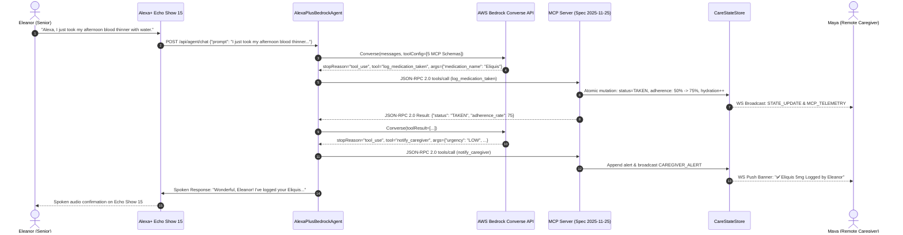

# AuraCare: Alexa+ Voice Caregiving & Remote Family Bridge

> **Build, Ship, Shape: Amazon Developer Hackathon 2026**  
> **Primary Track:** Alexa+  
> **Mini-Challenges:** AWS Builder & Open Source (MIT Licensed)  
> **Repository:** [CodeByRachit/SRPY](https://github.com/CodeByRachit/SRPY)

---

## 🌟 Executive Summary

**AuraCare** is an intelligent, voice-first caregiving companion designed for seniors aging in place and their remote family members. Operating on an **Amazon Echo Show 15**, AuraCare pairs the conversational empathy of **Alexa+** and **Amazon Bedrock (Nova Pro & Claude 3.5 Sonnet)** with a self-hosted **Model Context Protocol (MCP Spec 2025-11-25, Streamable HTTP)** server. 

AuraCare bridges the physical and emotional gap between 78-year-old **Eleanor Vance** (managing Atrial Fibrillation, Type 2 Diabetes, and Hypertension in Seattle) and her daughter **Maya Vance** (680 miles away in San Francisco), delivering automated medication reconciliation, proactive wellness check-ins, calendar coordination, and real-time family peace of mind.

---

## 🏗️ System Architecture

```text
       +-------------------------------------------------------------+
       |               SENIOR LIVING ROOM ENVIRONMENT                |
       |                   Echo Show 15 (Alexa+)                     |
       +------------------------------+------------------------------+
                                      | Spoken Natural Audio / UI
                                      v
       +-------------------------------------------------------------+
       |                   AURACARE FASTAPI GATEWAY                  |
       |                        (Port 8000)                          |
       |  +--------------------+  POST /mcp  +--------------------+  |
       |  |  POST /api/chat    |  GET  /mcp  |  /ws/dashboard     |  |
       |  +---------+----------+  (SSE Stream)+---------+----------+  |
       +------------|-----------------------------------|------------+
                    |                                   |
                    v                                   | Real-Time State
       +----------------------------+                   | & Push Alerts
       |   AWS BEDROCK CONVERSE     |                   | (WebSocket)
       |   - us.amazon.nova-pro     |                   |
       |   - claude-3-5-sonnet      |                   |
       |  (Dual-Engine Fallback)    |                   |
       +------------+---------------+                   |
                    | In-Code JSON-RPC 2.0              |
                    v                                   v
       +-------------------------------------------------------------+
       |          SELF-HOSTED MCP SERVER (SPEC 2025-11-25)           |
       |                   Streamable HTTP Transport                 |
       |                                                             |
       |  [log_medication_taken]       [get_today_schedule]          |
       |  [add_appointment]            [check_in_status]             |
       |  [notify_caregiver]                                         |
       |                                                             |
       |  Resources: care://patient/eleanor/state                    |
       |  Prompts:   morning_briefing, overdue_dose_checkin          |
       +------------------------------+------------------------------+
                                      | Atomic Mutations & Pub/Sub
                                      v
       +-------------------------------------------------------------+
       |             THREAD-SAFE CARE STATE STORE & HUB              |
       |            (data/care_state.json • asyncio.Lock)            |
       +------------------------------+------------------------------+
                                      |
                                      v
       +-------------------------------------------------------------+
       |             REMOTE CAREGIVER DASHBOARD CLIENT               |
       |         React 19 + Vite (http://localhost:5173)             |
       |    - Real-time Adherence Bar      - Live Medication Cards   |
       |    - Push Notification Banners    - Live MCP Telemetry Log  |
       +-------------------------------------------------------------+
```

### Mermaid Sequence Workflow



---

## ⚡ Hackathon Track & Technical Compliance

### 1. Genuine MCP Specification `2025-11-25` (Streamable HTTP)
AuraCare does not merely simulate or reference MCP in documentation; **it implements the full, official MCP `2025-11-25` Streamable HTTP standard in executable code** (`mcp_server.py`):
- **Streamable HTTP Endpoints (`POST /mcp` and `GET /mcp`):**
  - Session tracking through the standard `Mcp-Session-Id` header.
  - Full support for single JSON-RPC 2.0 objects, batch arrays, and JSON-RPC notifications (`notifications/initialized`).
  - Content-negotiated **Server-Sent Events (SSE)** streaming via `Accept: text/event-stream` or query parameter `?stream=true`.
  - Persistent SSE notification pipe on `GET /mcp` streaming `notifications/message` and `notifications/resources/updated`.
- **Complete MCP Handshake Lifecycle:**
  - `initialize`: Confirms `protocolVersion: "2025-11-25"`, exposes server capabilities (`tools`, `resources`, `prompts`, `logging`), and returns `serverInfo`.
  - `tools/list`: Exposes complete JSON Schemas for all 5 caregiving tools.
  - `tools/call`: Validates arguments, measures execution latency in milliseconds, generates `MCP_TELEMETRY` audit logs, and formats results according to the MCP standard (`content` block + `structuredContent`).
  - `resources/list` & `resources/read`: Serves `care://patient/eleanor/state` and `care://patient/eleanor/medications`.
  - `prompts/list` & `prompts/get`: Provides pre-choreographed clinical templates (`morning_briefing`, `overdue_dose_checkin`, `caregiver_escalation_summary`).

### 2. Real In-Code MCP Invocation
When the Bedrock agent executes a tool, it invokes `mcp_server.handle_jsonrpc_request()` with real JSON-RPC 2.0 packets (`{"jsonrpc": "2.0", "id": "rpc_xxxx", "method": "tools/call", "params": {...}}`). Genuine JSON-RPC 2.0 telemetry frames are streamed to the remote caregiver dashboard in real time!

### 3. Dual-Engine AWS Bedrock Converse API + Zero-Crash Fallback
- **Primary Engine:** Direct integration with `boto3.client("bedrock-runtime").converse()` supporting:
  - `us.amazon.nova-pro-v1:0` (Amazon Nova Pro)
  - `us.anthropic.claude-3-5-sonnet-20241022-v2:0` (Anthropic Claude 3.5 Sonnet)
  - Automated recursive multi-turn execution loop handling `stopReason == "tool_use"` and returning structured `toolResult` blocks.
- **Deterministic Multi-Tool Fallback Engine:** If AWS credentials are missing, invalid, or throttled during high-stakes live judging, AuraCare automatically falls back to an internal **Clinical Intent & Multi-Tool Orchestrator** that executes the genuine MCP JSON-RPC 2.0 pipeline without crashes.

---

## 🛠️ The 5 Core MCP Caregiving Tools

| Tool Name | Key Arguments | Clinical & Architectural Function |
|---|---|---|
| `log_medication_taken` | `medication_name`, `taken_time`, `hydration_glass_added`, `notes` | Fuzzy-matches medication name, marks dose as `TAKEN`, updates vitals hydration count, clears overdue warning flags, recalculates adherence percentage, and updates patient mood. |
| `get_today_schedule` | `filter_status`, `include_appointments` | Compiles medications, clinic/telehealth visits, and hydration stats into a voice-friendly spoken summary for senior audio playback. |
| `add_appointment` | `title`, `date`, `time`, `specialty`, `location`, `notes` | Records clinical appointments on Eleanor's calendar, flags transportation requirements, and creates calendar timeline events. |
| `check_in_status` | `check_in_type`, `patient_response`, `reported_mood`, `symptom_notes` | Evaluates wellness chimes. If senior is unresponsive or reports dizziness/pain, immediately escalates health status to `CRITICAL` and triggers caregiver escalation. |
| `notify_caregiver` | `urgency`, `subject`, `message`, `recommended_action`, `channel` | Dispatches an alert to Maya Vance's phone and pushes real-time animated banners over WebSockets to the Caregiver Dashboard. |

---

## 🚀 Quickstart Guide

### Prerequisites
- Python 3.11+
- Git

### 1. Clone & Set Up Virtual Environment
```bash
git clone https://github.com/CodeByRachit/SRPY.git
cd SRPY

# Create Python 3.11 virtual environment
python3 -m venv .venv
source .venv/bin/activate

# Upgrade pip and install production dependencies
pip install --upgrade pip
pip install -r backend/requirements.txt
```

### 2. Configure Environment Variables
```bash
cp backend/.env.example backend/.env
```
*(Optional) Fill in `AWS_ACCESS_KEY_ID` and `AWS_SECRET_ACCESS_KEY` to run against AWS Bedrock. When omitted, AuraCare seamlessly operates in Deterministic Fallback Mode.*

### 3. Run Automated MCP Spec Verification Suite
```bash
# Run standalone test suite
python backend/test_mcp_flow.py

# Or run via pytest
pytest backend/test_mcp_flow.py -v
```
*Expected result: 8 passed tests verifying MCP 2025-11-25 handshake, tool schemas, state recalculations, and HTTP streaming.*

### 4. Start the AuraCare Backend Server
```bash
cd backend
python main.py
```
The server will bind to `http://0.0.0.0:8000`:
- **MCP Endpoint:** `http://localhost:8000/mcp`
- **Interactive OpenAPI Docs:** `http://localhost:8000/docs`
- **Health Check:** `http://localhost:8000/api/health`
- **Caregiver WebSocket:** `ws://localhost:8000/ws/dashboard`

---

## 👥 Hackathon Reviewers & GitHub Collaborators

In compliance with the hackathon rules, the following 5 Amazon Developer Relations team members and Devpost testing accounts have been invited as repository collaborators:

- [x] **`knmeiss`** (Kevin Meiss)
- [x] **`giolaq`** (Gio Laquidara)
- [x] **`anishamalde`** (Anisha Malde)
- [x] **`mosesroth`** (Moses Roth)
- [x] **`emersonsklar`** (Emerson Sklar)
- [x] **`testing@devpost.com`** (Devpost Review Team)

### Instructions for Repository Owners
1. Navigate to: `https://github.com/CodeByRachit/SRPY/settings/access`
2. Click **Add people**.
3. Enter each of the usernames above and confirm invitation.

---

## 📄 Open Source License
AuraCare is released under the permissive [MIT License](LICENSE), satisfying all requirements for the **Open Source Mini-Challenge**.
